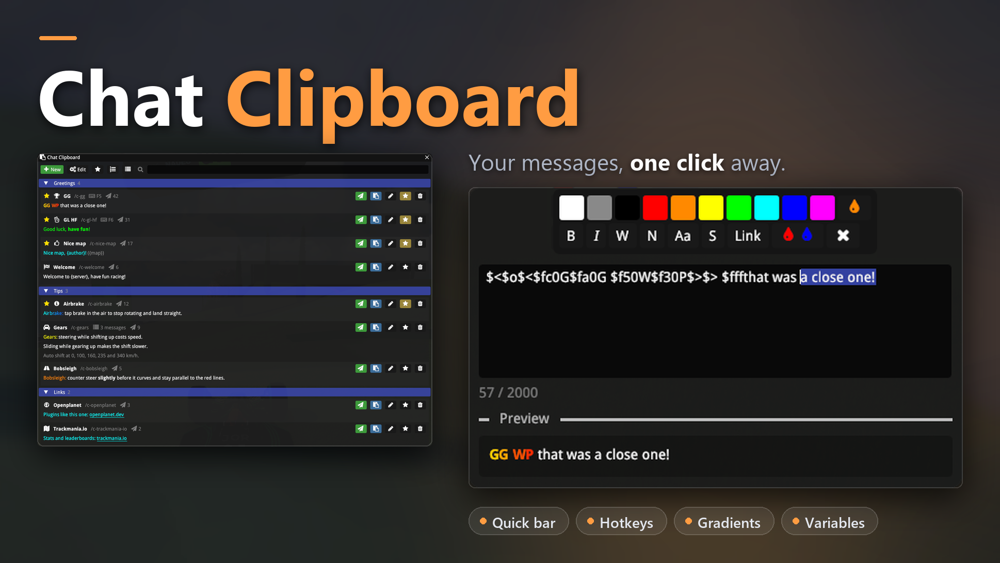
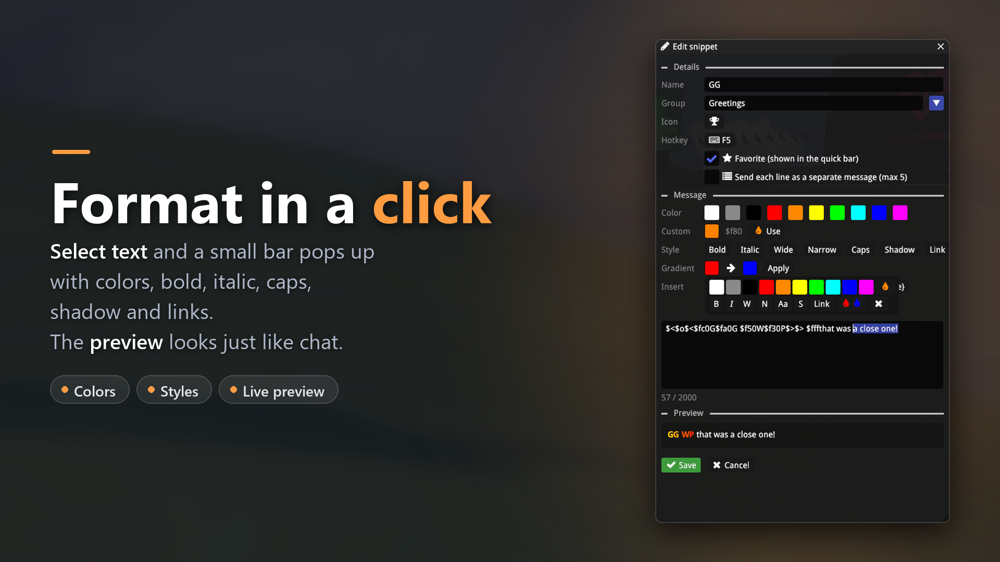
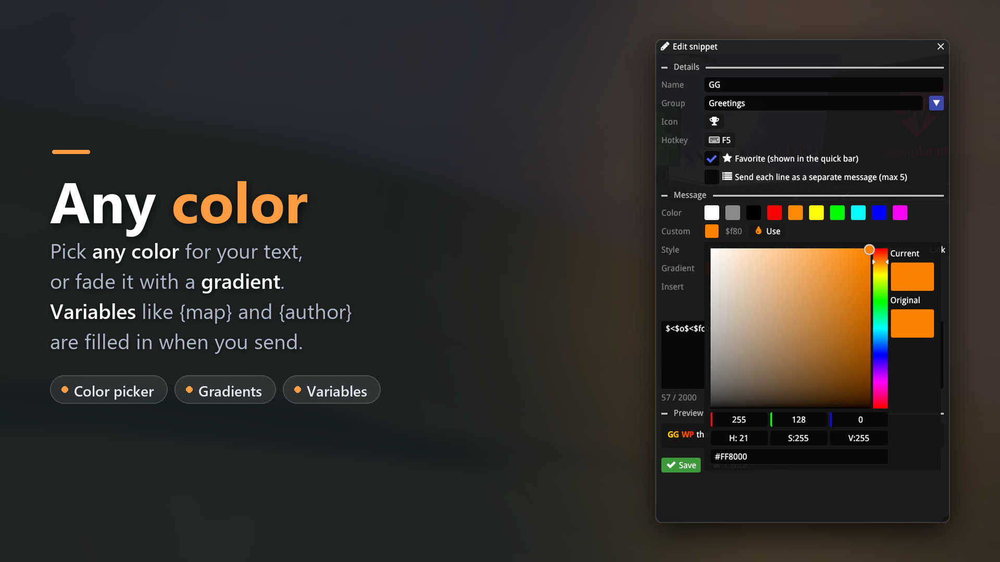
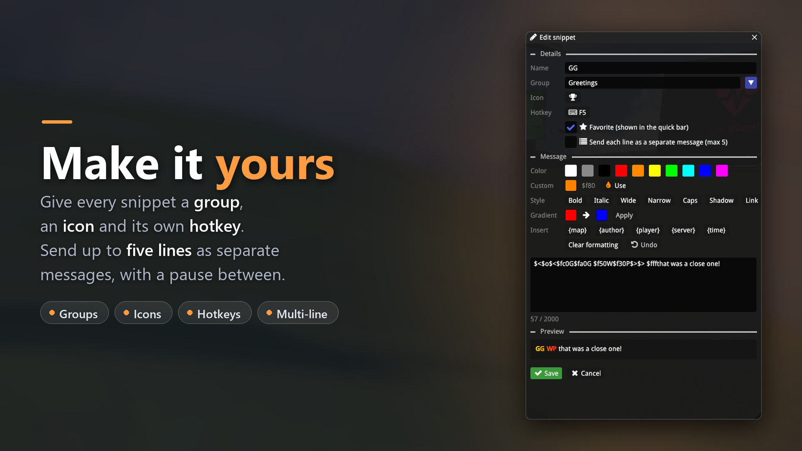
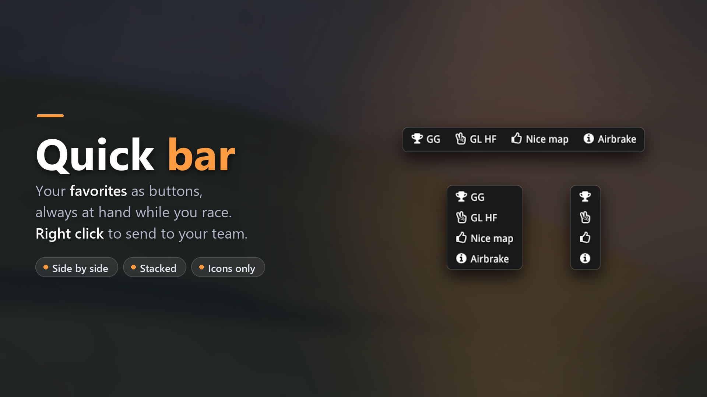

# Chat Clipboard



An [Openplanet](https://openplanet.dev/) plugin for Trackmania 2020 that keeps the chat messages you send again and again (greetings, tips you keep explaining, links) and sends them for you with one click, a hotkey or a chat command.

[**Get it on Openplanet**](https://openplanet.dev/plugin/chatclipboard) (in review, available once approved) · Requires [Better Chat](https://openplanet.dev/plugin/betterchat)

## Features

### Format in a click



Trackmania chat uses format codes such as `$f00` for red and `$o` for bold. You don't have to remember them: select part of your message and a small bar pops up with colors, bold, italic, wide, narrow, caps, shadow and links. The codes are wrapped in `$<...$>`, so the rest of the message keeps its own formatting. The preview underneath shows the message exactly like the game's chat will, and a counter warns you before a message gets too long.

### Any color



- Pick any color with the color picker, or fade text letter by letter with a **gradient**. Existing bold, italics and links in the selection are kept.
- **Variables** are filled in when you send: `{map}`, `{author}`, `{player}`, `{server}` and `{time}`. "Nice map, {author}!" always names the right person.

### Make it yours



- **Groups** list snippets under collapsible headings, for example *Greetings*, *Tips* and *Links*.
- **Icons**: about 50 to choose from, shown in the list, on the quick bar and in Better Chat's suggestions.
- **Hotkeys**: give a snippet its own key, like F5 for "GG". Hotkeys never fire while you're typing.
- **Multi-line**: send up to five lines as separate chat messages, with an adjustable pause in between and a progress indicator you can stop.

### Quick bar



Your favorite snippets as buttons, always on screen while you race. Lay it out side by side or stacked, show icons only, and set how see-through it is. Right click a button to send to your team; that option is only offered when you're in a team.

### And more

- **Chat commands**: every snippet gets a command like `/clip-gg`, shown in Better Chat's command suggestions with a preview. The prefix can be changed.
- **A button in Better Chat** opens the clipboard window. The Openplanet menu, `/clipboard` and an optional toggle key work too.
- **Favorites, sorting** (manual, most used, by name), a **compact view** and a **filter** keep long lists manageable.
- **Edit mode** adds buttons to duplicate and reorder. Deleting asks for a second click and can be undone for 10 seconds.
- **No accidental spam**: after sending, the buttons wait a moment (adjustable), so a double click can't send twice. Nothing is sent while a map is loading.

## Installation

Install **Chat Clipboard** from the plugin manager in the Openplanet overlay (F3 → Openplanet → Plugin manager), or from its [page on openplanet.dev](https://openplanet.dev/plugin/chatclipboard). It needs [Better Chat](https://openplanet.dev/plugin/betterchat); install that as well if you don't have it yet.

To try the latest code from this repository instead, run `./build.ps1 -Install`. That builds `dist/ChatClipboard.op` and copies it into `OpenplanetNext/Plugins`. Openplanet only loads unsigned builds like this one with its signature mode set to **Developer**.

## Getting started

1. Join a server and open the overlay (F3). Click the clipboard button in Better Chat's sidebar, or use **Plugins → Chat Clipboard**.
2. Click **New**, give the snippet a name and type your message. Format it with the toolbar or by selecting text.
3. Star it to put it on the quick bar, or give it a hotkey in the editor.
4. Send it from the quick bar, the hotkey, the window, or by typing `/clip-` and its name in chat.

## Settings

Under **Settings → Chat Clipboard**:

| Tab | Settings |
|---|---|
| General | Show the window without the overlay, a key to toggle the window, snippet hotkeys on or off, the wait after sending, the pause between lines, and whether copying shows a message in chat |
| Quick bar | Show it, show it without the overlay, icons only, vertical layout, background opacity |
| Better Chat | The command prefix (`clip-` by default), the per-snippet commands, and the button in Better Chat's sidebar |

## Storage

Snippets are saved to `OpenplanetNext/PluginStorage/ChatClipboard/chat_clipboard.json`. In edit mode, the folder button opens that folder, which is handy for backups. Files from older versions are converted automatically. If the file can't be read, a copy is kept as `chat_clipboard.json.bak` before the defaults are loaded.

## Development

```
src/
  Main.as              entry points, /clipboard command, sending and copying
  Settings.as          plugin settings
  Snippets.as          snippet model, loading and saving
  Variables.as         {map}, {author}... placeholders
  Hotkeys.as           snippet hotkeys, toggle key, picking a key in the editor
  Style.as             shared button and preview styles
  FormattedText.as     draws format codes like the game does (Openplanet UI only knows colors and italics)
  Interface.as         clipboard window
  Editor.as            snippet editor with formatting toolbar and selection bar
  SnippetIcons.as      the icons a snippet can have, and the icon picker
  QuickBar.as          the favorites bar
  SnippetCommands.as   a /clip-<name> chat command per snippet
  BetterChatButton.as  button in Better Chat's sidebar (or top right of the chat if the sidebar is full)
```

`./build.ps1` packages `info.toml`, `LICENSE` and `src/` into `dist/ChatClipboard.op`; add `-Install` to copy it into the Openplanet plugins folder.

Better Chat has no API for extra buttons. `BetterChatButton.as` calls `UI::Begin()` with Better Chat's window title, which makes ImGui append to that window. This relies on Better Chat rendering before this plugin, and on its sidebar layout (6 buttons, 5 in big chat), so check it after Better Chat updates. It can be turned off in the settings.

Bugs and ideas are welcome in the [issues](https://github.com/jorranMLGN/ChatClipboard/issues).

## About the code

The code of this plugin was written with Claude Code, Anthropic's AI coding agent (model: Claude Opus 5.5), under my direction. I decided on the features and design, reviewed all of the code and tested it in game. The images are in-game screenshots, not generated.

## License

[MIT](LICENSE)
